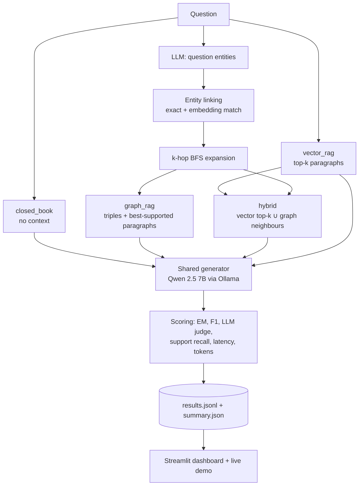

# Architecture

## Indexing (offline, once per corpus)

```mermaid
flowchart LR
    DS[(HotpotQA / MuSiQue sample)] --> P[grb prepare<br/>shared corpus + questions]
    P --> E[bge-base-en-v1.5<br/>embeddings]
    E --> V[(Vector index<br/>NumPy, exact cosine)]
    P --> X[Local LLM (Ollama, JSON schema)<br/>entities + relations per paragraph]
    X --> R[Entity resolution<br/>name normalisation]
    R --> G[(Knowledge graph<br/>NetworkX, optional Neo4j export)]
    X -. tokens, time .-> S[index_stats.json]
```

## Query time (same generator, prompt and token budget for every pipeline)


